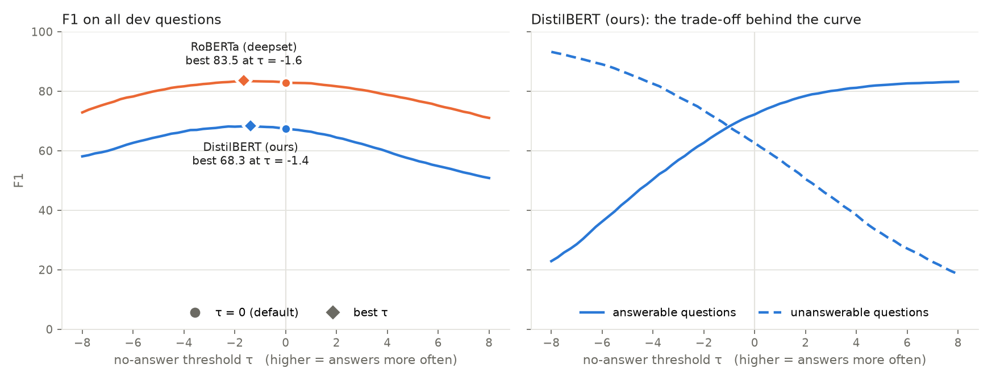
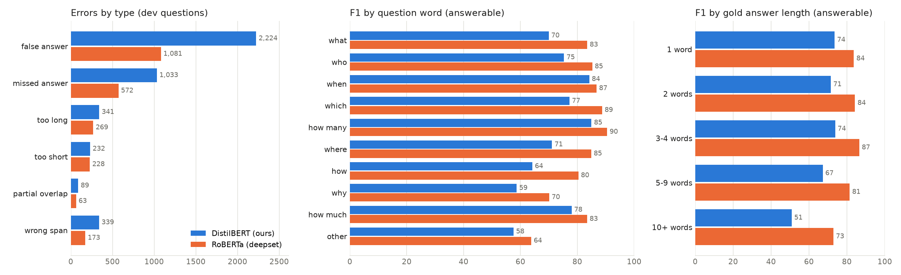

# AI Question Answering System

An extractive question answering system for CSCI 390 (Natural Language Processing and Applications, Dr. Qi Li).
Given a passage and a question, the model highlights the words in the passage that answer it, or says
**"no answer"** when the passage doesn't contain one.

We fine-tune [`distilbert-base-uncased`](https://huggingface.co/distilbert/distilbert-base-uncased) on
[SQuAD 2.0](https://rajpurkar.github.io/SQuAD-explorer/) and compare it with the published
[`deepset/roberta-base-squad2`](https://huggingface.co/deepset/roberta-base-squad2).

**Team:** David Falaye, Kosisochukwu Ogbuanya

## Status

| Week | Milestone | Status |
| --- | --- | --- |
| 1 | Pipeline works on a small sample | Done |
| 2 | Model trained and scored | Done: 67.4 F1 on the dev set (target was 65+) |
| 3 | Demo online | Demo done (run it from Colab or your computer); error analysis done |
| 4 | Report and presentation | Not started |

See [TASKS.md](TASKS.md) for the full task list.

## Try the demo

The demo is not hosted permanently, but anyone can start it in about two minutes:

- **In the browser, nothing to install:** open
  [notebooks/04_demo_colab.ipynb in Google Colab](https://colab.research.google.com/github/Davidfaleye360/AI-Question-Answering-System/blob/main/notebooks/04_demo_colab.ipynb)
  (needs a Google account), run its two code cells, and open the `gradio.live` link it prints.
- **On your own computer:** follow "Getting started" below, then run `python app/app.py`.

Our trained model is public at [Ingsyling/distilbert-squad2](https://huggingface.co/Ingsyling/distilbert-squad2),
so the demo downloads it by itself.

## Results

Scores on the SQuAD 2.0 dev set (11,873 questions), measured with `src/evaluate.py` at the default
no-answer threshold (τ = 0). Our model is [Ingsyling/distilbert-squad2](https://huggingface.co/Ingsyling/distilbert-squad2)
on the Hugging Face Hub. RoBERTa's model card reports 79.9 EM / 82.9 F1, which our measurement reproduces.
CPU time is the median time to answer one dev question end to end on an Apple M2 laptop (4 threads).

| Model | EM | F1 | HasAns F1 | NoAns F1 | Size | CPU time / question |
| --- | --- | --- | --- | --- | --- | --- |
| DistilBERT (ours) | 64.14 | 67.38 | 72.17 | 62.59 | 266 MB (66 M parameters) | 31 ms |
| RoBERTa (deepset) | 79.90 | 82.91 | 84.01 | 81.82 | 496 MB (124 M parameters) | 57 ms |

Our model is 15.5 F1 points behind RoBERTa at 54% of the size and 1.8 times the speed.

### Tuning the no-answer threshold

The model says "no answer" when the no-answer score beats its best span by more than τ. Lowering τ from 0
to about −1.4 makes our model abstain more often and raises F1 from 67.38 to 68.08. That second number is
cross-validated: τ is chosen on half of the dev articles and scored on the other half, so it is not flattered
by tuning on the questions it is scored on (doing that gives 68.30).

| Model | F1 at τ = 0 | Best τ | F1 at best τ (optimistic) | F1 cross-validated |
| --- | --- | --- | --- | --- |
| DistilBERT (ours) | 67.38 | −1.38 | 68.30 | 68.08 |
| RoBERTa (deepset) | 82.91 | −1.64 | 83.50 | 83.44 |



### Where the errors are

Our model gets 4,258 of the 11,873 dev questions wrong. Three quarters of those errors are about deciding
whether to answer at all, not about finding the span:

| Error type | DistilBERT (ours) | % of its errors | RoBERTa (deepset) |
| --- | --- | --- | --- |
| False answer: answered an unanswerable question | 2,224 | 52.2% | 1,081 |
| Missed answer: said "no answer" to an answerable question | 1,033 | 24.3% | 572 |
| Too long or too short: right place, different edges | 573 | 13.4% | 497 |
| Partial overlap or wrong span | 428 | 10.1% | 236 |

"Why" and "how" questions and answers of five or more words are the hardest for both models. We also read
60 of our model's errors one by one: most false answers come from trick questions that change one detail of
the passage or reverse its meaning, and the too long / too short answers we read were all ones a person
would accept. Details are in [notebooks/03_error_analysis.ipynb](notebooks/03_error_analysis.ipynb).



## Repository layout

```text
AI-Question-Answering-System/
├── README.md
├── TASKS.md                    # project task list
├── requirements.txt
├── configs/
│   ├── distilbert.yaml         # every setting in one place
│   └── smoke.yaml              # the few settings the 50-step smoke test changes
├── src/
│   ├── config.py               # loads the YAML config
│   ├── data.py                 # loads SQuAD 2.0
│   ├── preprocess.py           # tokenization, windows, start/end labels
│   ├── explore.py              # dataset statistics for the exploration notebook
│   ├── train.py                # fine-tuning with the Hugging Face Trainer
│   ├── postprocess.py          # start/end scores -> answer text or "no answer"
│   ├── evaluate.py             # EM and F1 on the dev set, overall and HasAns / NoAns
│   ├── threshold.py            # sweep the no-answer threshold, plot F1 against it
│   ├── predict.py              # answer one question (used by the demo and the benchmark)
│   ├── benchmark.py            # model size and CPU time per question
│   ├── errors.py               # error types, F1 by question word and answer length
│   └── demo.py                 # what the demo shows (no user-interface code)
├── app/
│   ├── app.py                  # the Gradio demo screen
│   ├── README.md               # for a Hugging Face Space (optional, see "The demo")
│   └── requirements.txt        # what such a Space would install
├── scripts/
│   ├── check_preprocessing.py  # sanity check: labels decode back to the right answers
│   └── deploy_space.py         # copies the demo to a Hugging Face Space (needs a paid plan)
├── notebooks/
│   ├── 01_explore_data.ipynb   # dataset stats + a ready-made model as a baseline
│   ├── 02_train_colab.ipynb    # training in Colab: smoke test, full run, dev-set score
│   ├── 03_error_analysis.ipynb # what the models get wrong, and why
│   └── 04_demo_colab.ipynb     # starts the demo in Colab with a public link
├── tests/                      # unit tests (no internet or GPU needed)
├── pytest.ini
└── results/
    ├── data_stats.md           # dataset statistics from notebook 01
    ├── distilbert-squad2.json                # our model's scores on the dev set
    ├── distilbert-squad2_predictions.json    # its answer and score for every dev question
    ├── distilbert-squad2_train_summary.json  # the full training run: settings and loss curve
    ├── roberta-base-squad2.json              # the same two files for RoBERTa
    ├── roberta-base-squad2_predictions.json
    ├── threshold_sweep.json                  # scores at every threshold, for both models
    ├── threshold_sweep.png                   # the figure above
    ├── efficiency.json                       # size and CPU time per question
    ├── error_breakdown.json                  # error types and F1 by question word / answer length
    ├── error_analysis.png                    # the figure for it
    └── error_sample.csv                      # 60 wrong predictions labelled by hand
```

Coming next: the long-document mode, the report.

## Getting started

### In Google Colab (recommended: free GPU)

1. Open a notebook from this repo in Colab: **File → Open notebook → GitHub**, paste the repo URL.
2. **Runtime → Change runtime type → T4 GPU.**
3. Run the first cell. It clones the repo and installs the requirements.

### On your own computer

```bash
git clone https://github.com/Davidfaleye360/AI-Question-Answering-System.git
cd AI-Question-Answering-System
python -m venv .venv
source .venv/bin/activate          # Windows: .venv\Scripts\activate
pip install -r requirements.txt
```

Run the unit tests (no internet or GPU needed):

```bash
pytest -q
```

Check preprocessing on real SQuAD data (downloads the dataset and tokenizer, about 50 MB):

```bash
python scripts/check_preprocessing.py --n-examples 2000
```

Run the training smoke test: 50 steps on 1% of the data. It works without a CUDA GPU (about 8 minutes on
an M2 MacBook with 8 GB of memory) and writes about 1.8 GB to `outputs/smoke`. It ends with `RESULT: PASS`
if the loss went down and the model was saved:

```bash
python -m src.train --config configs/distilbert.yaml --overrides configs/smoke.yaml --fresh
```

Score a model on the dev set. This downloads the model the first time (about 500 MB for RoBERTa), takes
about 6 minutes on an M2 MacBook, and writes two files to `results/`. Add `--limit 20 --show 20 --no-save`
to only look at the first 20 questions and the model's answers:

```bash
python -m src.evaluate --model deepset/roberta-base-squad2 --name roberta-base-squad2
```

Sweep the no-answer threshold (needs no model: it reads the saved predictions) and measure size and speed
(about a minute; downloads both models the first time):

```bash
python -m src.threshold --models distilbert-squad2 roberta-base-squad2 --labels "DistilBERT (ours)" "RoBERTa (deepset)"
python -m src.benchmark --models Ingsyling/distilbert-squad2 deepset/roberta-base-squad2
```

Run the demo on your own computer. It downloads our model the first time (about 270 MB) and opens at
http://127.0.0.1:7860. With `--share` it also prints a public `gradio.live` link that works for as long as
the program keeps running (one week at most):

```bash
python app/app.py
python app/app.py --share
```

## The demo

`app/app.py` is a Gradio app. You paste a passage and ask a question, and it shows:

- the answer, or "No answer found in the passage"
- the passage with the answer highlighted (when the model abstains, its rejected best guess is shown in grey)
- the top five candidate spans and "no answer", with their scores
- a threshold slider: moving it re-decides instantly from the same scores, without running the model again
- a switch between our DistilBERT and the RoBERTa baseline

Long passages work too: they are read in overlapping windows, like in training.

**Hosting.** We planned to host the demo on a Hugging Face Space. Hugging Face now requires a paid PRO plan
for Gradio Spaces, so instead the demo is started on demand, from Colab or a laptop, with a public link.
`scripts/deploy_space.py` still works for anyone with a PRO account: `python scripts/deploy_space.py --space <user>/<name>`.

## How the pipeline works

1. **Load** SQuAD 2.0 from the Hugging Face Hub (`rajpurkar/squad_v2`).
2. **Preprocess** (`src/preprocess.py`): tokenize question and passage together, split long passages into
   overlapping windows (384 tokens, 128 overlap), and convert each answer's character position into
   start and end token labels. Unanswerable questions, and windows that don't contain the whole answer,
   are labeled `(0, 0)`, which points at the `[CLS]` token.
3. **Train** (`src/train.py`): fine-tune DistilBERT with the Hugging Face `Trainer`, saving checkpoints
   along the way so a run can continue after a Colab disconnect. The full run (2 epochs, 16,470 steps, 44 minutes
   on a T4) is in `notebooks/02_train_colab.ipynb`: checkpoints go to Google Drive and the finished model
   is uploaded to the Hugging Face Hub as `Ingsyling/distilbert-squad2`.
4. **Post-process** (`src/postprocess.py`): the model gives every token a start score and an end score.
   The best answer is the span with the highest start + end score, among spans that lie inside the passage
   and are at most 30 tokens long. "No answer" has a score too (the `[CLS]` token), and the model abstains
   when that score beats the best span by more than a threshold τ.
5. **Evaluate** (`src/evaluate.py`): Exact Match and F1 on the dev set, overall and separately for
   answerable (HasAns) and unanswerable (NoAns) questions, checked against the official SQuAD 2.0 metric.

## Configuration

All settings live in [`configs/distilbert.yaml`](configs/distilbert.yaml), so experiments are easy to
reproduce and compare. Don't hard-code numbers in notebooks; read them from the config.

## References

- Rajpurkar, Jia & Liang (2018). [Know What You Don't Know: Unanswerable Questions for SQuAD](https://arxiv.org/abs/1806.03822).
- Sanh et al. (2019). [DistilBERT, a distilled version of BERT](https://arxiv.org/abs/1910.01108).
- Hugging Face. [LLM Course, chapter 7.7: Question answering](https://huggingface.co/learn/llm-course/chapter7/7).
